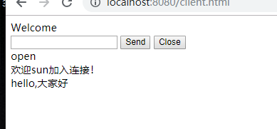
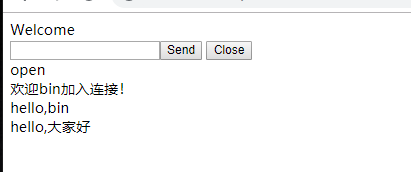
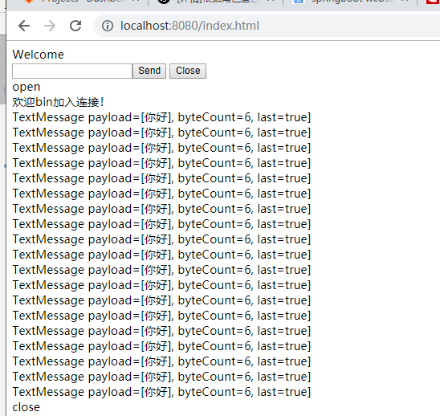

# websocket
Spring Boot integration with WebSocket to implement message pushing (active push, specific user push, group broadcast, and scheduled push).

* Developing a private instant messaging system with Spring Boot (WebSocket): https://www.jianshu.com/p/0f498adb3820 Project Address: https://gitee.com/anoyi/anyim

* Building interactive web applications with WebSocket:
This guide will walk you through the process of creating a "hello world" application that sends messages back and forth between a browser and a server. WebSocket is a very thin, lightweight TCP layer. It is highly suitable for embedding messages using "sub-protocols." In this guide, we will dive deeper and use Spring's STOMP messaging to create interactive web applications.
https://spring.io/guides/gs/messaging-stomp-websocket/

## Principle Illustration (Difference from traditional HTTP requests)

## There are two ways to use WebSocket:
* 1. Using sockjs,
* 2. Using the H5 standard. Using the HTML5 standard is naturally more convenient and simple, so this record documents the usage method in conjunction with H5 (there are two cases, with two `websocketserver` classes corresponding to different HTML pages).

* Case 2 is designed to test several WebSocket methods targeting different users.

## pom
* The core is the `@ServerEndpoint` annotation. This annotation is part of the JavaEE standard and has been implemented in Tomcat 7 and above.
  If you are using traditional methods to deploy a project with Tomcat, you can use it simply by introducing the JavaEE standard in the pom file.
  
      <dependency>
        <groupId>javax</groupId>
        <artifactId>javaee-api</artifactId>
        <version>7.0</version>
        <scope>provided</scope>
      </dependency>
      
* However, when using Spring Boot's embedded Tomcat, there is no need to introduce `javaee-api` as it is already included in spring-boot. To use Spring Boot's WebSocket functionality, first introduce the Spring Boot starter:

        <dependency>
            <groupId>org.springframework.boot</groupId>
            <artifactId>spring-boot-starter-websocket</artifactId>
            <version>1.3.5.RELEASE</version>
        </dependency>
     
* As a side note, Spring Boot's advanced starters automatically reference basic components. For example, `spring-boot-starter-websocket` introduces `spring-boot-starter-web` and `spring-boot-starter`, so do not introduce them redundantly.

## Configuration Class (WebSocketConfig)
* Use `@ServerEndpoint` to create a WebSocket endpoint [Configure endpoint class and specific implementation: `WebSocketServer`].
  First, `ServerEndpointExporter` must be injected. This bean automatically registers WebSocket endpoints declared with the `@ServerEndpoint` annotation.
  Note: If you are using a standalone servlet container instead of Spring Boot's embedded container, do not inject `ServerEndpointExporter`, as it will be provided and managed by the container itself.
  
## Testing Case 1
* 1. Start the project.
* 2. Enter `http://localhost:8080/websocket.html` in the browser.
* 3. You can open multiple pages; the backend console will print changes in the number of currently online users.

## Testing Case 2
* 1. Visit `http://localhost:8080/index.html` and `http://localhost:8080/client.html` to open two separate pages and connect them to the WebSocket.
* 2. Use `http://localhost:8080/socket?userName=lily&message=helloworld` to send a message to lily.
* 3. Use `http://localhost:8080/webSocket/socket/all?message=hello, everyone` to broadcast a message to all online users.

* Sending messages via scheduled tasks:

